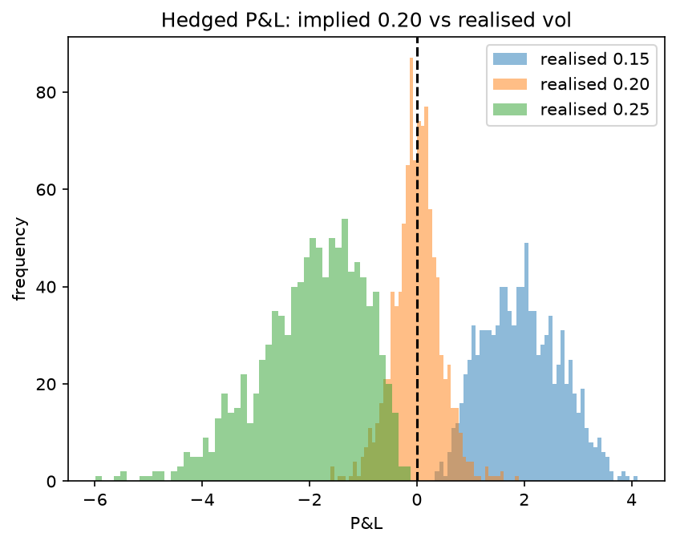
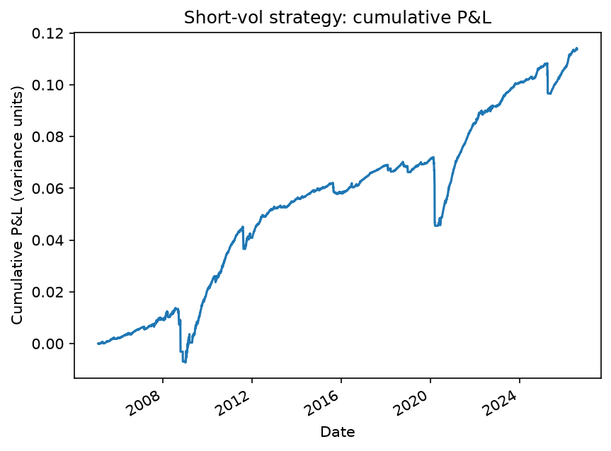
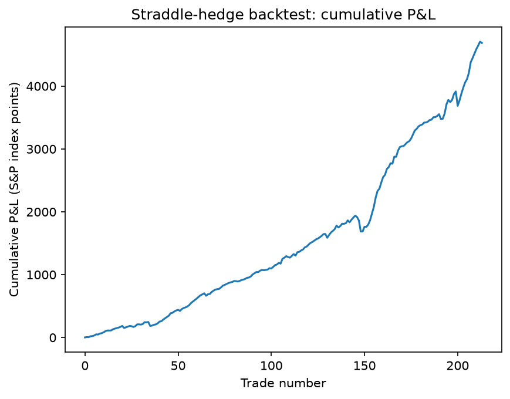

# Options Pricer

A Python options pricing tool implementing the Black-Scholes model, built from scratch to develop a practical understanding of derivatives pricing and risk sensitivities.

## Features

- European call and put pricing using the Black-Scholes model
- All five Greeks: delta, gamma, theta, vega, rho
- Implied volatility extraction from market prices using a Brent root-finder
- Live volatility smile construction from real option chain data (yfinance)
- Interactive Streamlit dashboard with real-time pricing and Greeks
- Pytest suite validating all Greeks against finite-difference approximations (100% coverage)
- Continuous integration via GitHub Actions

## How to run

pip install -r requirements.txt
streamlit run app.py

## Built with

Python, NumPy, SciPy, Matplotlib, yfinance, Streamlit

## What I learned

Building this from first principles gave me a working understanding of how option prices respond to their inputs, why the Greeks matter for risk management, and how implied volatility is extracted from market prices in practice. Plotting the volatility smile from live market data made clear where the Black-Scholes assumptions break down in real markets.

## Delta-Hedging Simulator

A Monte Carlo simulation of the classic short-volatility trade: sell an option, hedge away its directional risk, and profit (or lose) purely on the gap between the volatility you sold at and the volatility the market actually delivers.

### What it does

`hedging.py` simulates a market maker who sells a call option and hedges it daily. The option is priced at an assumed implied volatility, while the underlying stock path is generated at a separate realised volatility. This lets us ask the central question of options market-making: what happens when the world moves more, or less, than the price implied?

- `simulate_path` generates a stock price path using geometric Brownian motion.
- `simulate_hedge` sells one call, buys the delta hedge, then rebalances every day as the price and time-to-expiry change, tracking cash (including interest) through to expiry. It returns the final P&L.
- `attribute_pnl` decomposes the P&L into its two opposing drivers: theta (time-decay income) and gamma (the cost of rehedging).

### Key result

Running 1,000 simulated paths for each scenario, with implied volatility fixed at 20%:

| Realised vol | Mean P&L | Interpretation                          |
|--------------|----------|-----------------------------------------|
| 15%          | +1.97    | Sold vol high, market stayed calm, win  |
| 20%          | ~0.00    | Fairly priced, break-even               |
| 25%          | −1.99    | Sold vol low, market was wild, loss     |

The three distributions sit cleanly left, on, and right of zero. The P&L is approximately vega × (implied − realised), which the simulation reproduces from first principles. The loss distribution is wider and more negatively skewed than the win distribution, which is the signature risk profile of short-volatility strategies: frequent small gains, occasional large losses.

### Why direction doesn't matter

Because the position is delta-hedged, the direction of each move is cancelled out and only the size of moves matters. This is why P&L depends on realised volatility, not realised return: a stock that swings wildly but ends flat still generates large hedging costs. The gamma term makes this explicit, since the cost of each move scales with the square of the price change, which strips out its sign.

### P&L attribution

For the break-even case (realised = implied = 20%), the simulator confirms the P&L is the near-cancellation of two large forces:

- Theta collected: +4.39 (time-decay income banked for being short)
- Gamma paid: −3.82 (buy-high/sell-low cost of rehedging)

The small residual reflects higher-order terms and interest not captured by the first-order attribution.

## Variance Risk Premium Backtest

A systematic test of the short-volatility trade on 20 years of real market data. The question: does selling S&P 500 volatility, and collecting the gap between implied and realised vol, actually make money, and does the edge survive realistic trading costs?

### The idea

Implied volatility (what the market charges for options, via the VIX) tends to sit above realised volatility (what the market actually delivers). That persistent gap is the variance risk premium, and a short-vol seller harvests it. This backtest builds a signal around the gap and evaluates it honestly, with transaction costs and an out-of-sample test.

### Method

Data comes from the S&P 500 (`^GSPC`) and VIX (`^VIX`), 2005 to present, via yfinance. VIX is used as implied volatility, and realised volatility is computed from a rolling window of S&P returns.

The signal goes short vol on days where the gap (implied − realised) exceeds a threshold, so only when options look expensive relative to actual movement.

Each day's P&L is modelled as implied variance sold minus actual realised variance that day, which is equivalent to theta income minus gamma cost, the two forces driving a delta-hedged short option. Realised variance is measured from actual squared daily returns rather than a smoothed estimate, so single-day crash losses (such as March 2020) are captured rather than averaged away.

A per-day transaction cost is charged on days in the trade. The signal threshold is tuned on 2005 to 2014 (in-sample) and then tested, untouched, on 2015 to 2025 (out-of-sample).

### Results

Out-of-sample, the best in-sample threshold returned +0.087 on 2005 to 2014 and still +0.070 on the 2015 to 2025 data it was never tuned on, so the edge generalises rather than being curve-fit.

The edge is thin, though. At around 0.1bp per day it survives; at 1bp per day every threshold turns negative. Profitability depends on institutional-grade execution costs.

### Full straddle-hedge validation

As a cross-check, the analytical P&L above is validated against a full options simulation. On each signal month, a 1-month at-the-money straddle is sold and delta-hedged day by day along the actual S&P path, priced with the Black-Scholes engine in `pricing.py`. This connects the pricer, the hedger, and the backtest into one system.

Over 214 trades the two methods agree in shape and sign. The edge is real, with a hit rate around 84% and occasional sharp losses (the worst single trade falls in the 2020 crash). The annualised Sharpe is about 1.9, though this flatters the strategy: short-vol returns are negatively skewed, so a standard-deviation-based Sharpe understates the true tail risk.

### Conclusion

The variance risk premium is real and generalises out-of-sample, but it is thin and carries sharp tail risk. It is only tradeable with very low execution costs, which is why this trade belongs to low-cost institutional players rather than retail.